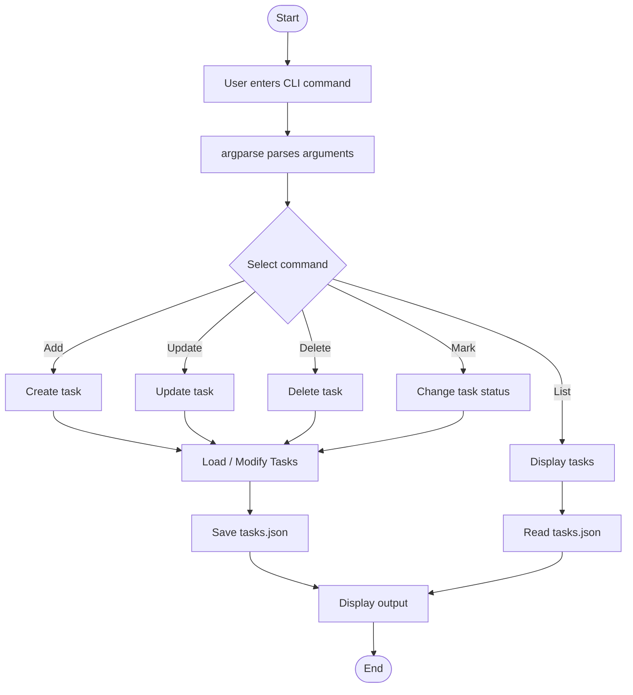

# Task Tracker CLI

A simple command-line application built with Python to manage daily tasks. It supports adding, updating, deleting, tracking task status, and filtering tasks using a JSON file for persistent storage.
# project URl

https://roadmap.sh/projects/task-tracker

## Features

- Add, update, and delete tasks.
- Mark tasks as `in-progress` or `done`.
- List all tasks.
- Filter tasks by status (`todo`, `in-progress`, `done`).
- Automatically store tasks in `tasks.json`.
- Handle invalid inputs and missing tasks.

## Project Structure

```text
task-tracker/
│
├── task_cli.py
├── tasks.json
└── README.md
```

## Application Flow



## Installation & Usage

**1. Clone the repository**

```bash
git clone <your-repository-url>
cd task-tracker
```

**2. Add a task**

```bash
python task_cli.py add "Learn Python"
```

**3. Update a task**

```bash
python task_cli.py update 1 "Learn Python functions"
```

**4. Delete a task**

```bash
python task_cli.py delete 1
```

**5. Update task status**

```bash
python task_cli.py mark-in-progress 1
python task_cli.py mark-done 1
```

**6. List tasks**

```bash
python task_cli.py list
python task_cli.py list todo
python task_cli.py list in-progress
python task_cli.py list done
```

## Task Data Structure

Tasks are stored in `tasks.json` in JSON format.

```json
{
  "id": 1,
  "description": "Learn Python",
  "status": "todo",
  "createdAt": "2026-11-07T10:00:00+00:00",
  "updatedAt": "2026-11-07T10:00:00+00:00"
}
```

## Technologies Used

- Python 3
- argparse
- JSON
- pathlib
- datetime

No external libraries or frameworks required.

## Learning Outcomes

- Command-line argument handling
- Python functions and data structures
- File handling and JSON operations
- CRUD operations
- Error handling and validation

---

**Project:** Task Tracker CLI  
**Language:** Python  
**Storage:** JSON  
**Type:** Command Line Application